# Browser client for get-access

> **Примечание:** на данный момент это сырой прототип, проект на стадии разработки. Однако, вы можете посмотреть, как это будет выглядеть в будущем.

GetAccess - это современный менеджер паролей, позволяющий хранить и управлять своими учетными данными от различных онлайн-сервисов в одном надежном и удобном месте.

Ниже представлены страницы браузерного приложения с перечислением возможностей

---
## Login and registrate

- Базовые окна для получения прав доступа к приложению.

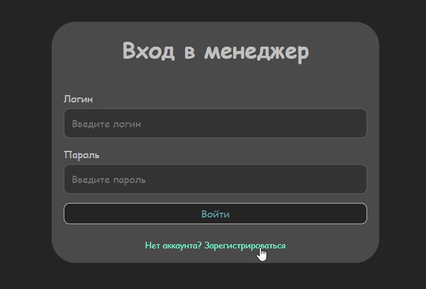

- На странице регистрации можно также привязать другие сервисы для дополнительной защиты, и возможно в будущем, дополнительных функций сервиса.

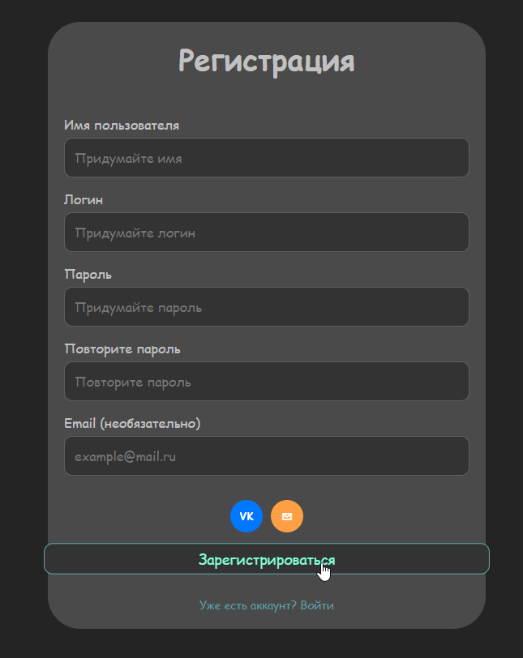

---
## Main page - manager GetAccess

Главная страница менеджера, где располагается таблица со всеми добавленными онлайн-сервисами пользователя. Основные возможности:
- Просмотр списка онлайн-сервисов;
- Быстрое копирование логина или пароля по нажатию на соответствующую иконку;
- Удаление сервиса из списка по нажатию на корзину;
- Добавление новой записи по кнопке (см. описание Adding page);

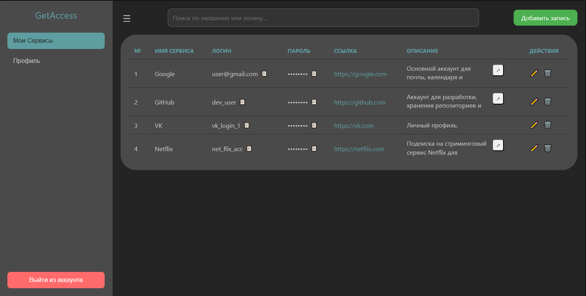

- Просмотр полного описания сервиса по нажатию на иконку

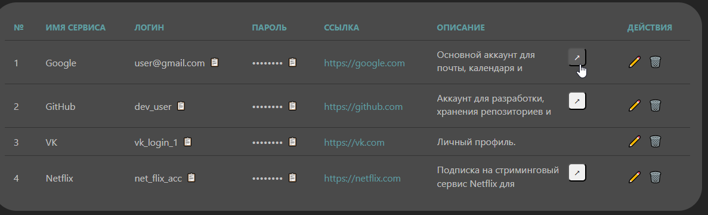

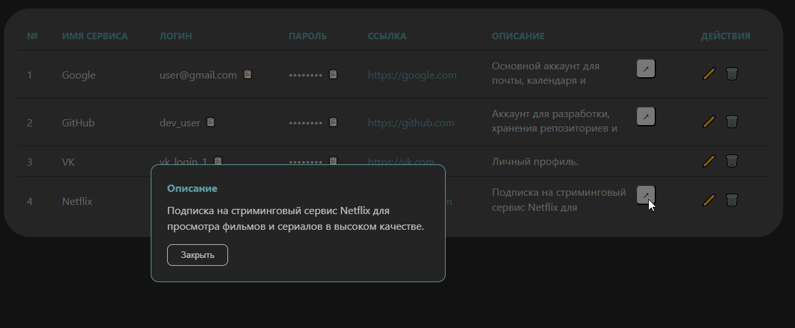

- Редактирование данных сервиса по нажатию на карандаш - действие можно применить и отменить по соответствующим иконкам;

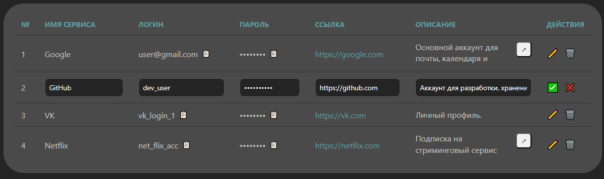

- Горячий поиск по полям "Имя сервиса" и "Логин", для быстрого поиска нужных данных.

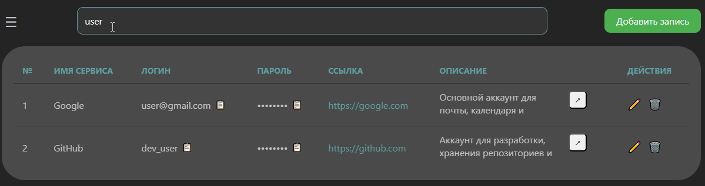

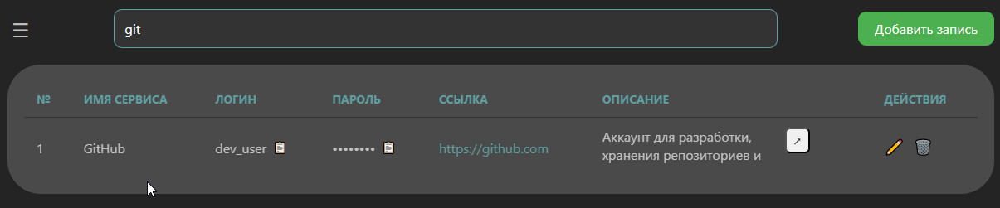

---
## Adding page

- Добавление новой записи (сервиса) при заполнении обязательных данных;
- Скрытие пароля при вводе в поле;
- Генерация случайного пароля (как доп. функция для удобства)

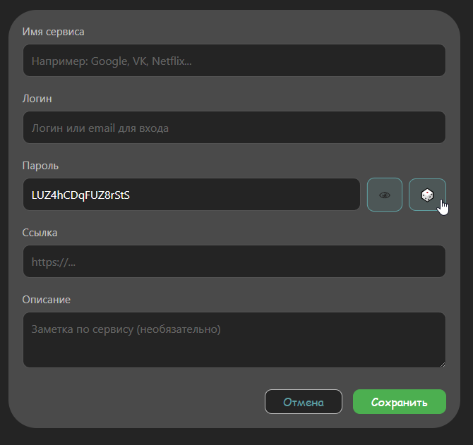

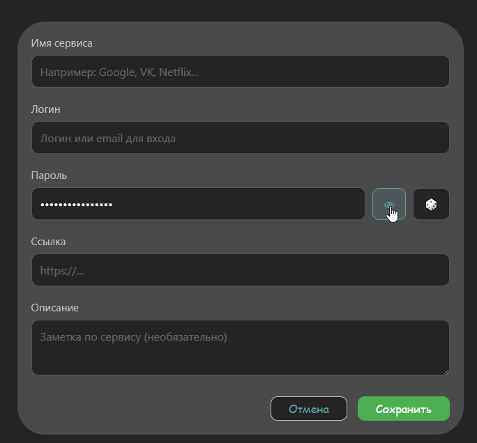

---
## Profile page

- Просмотр профиля с данными пользователя
- Привязка и отвязка доп. сервисов

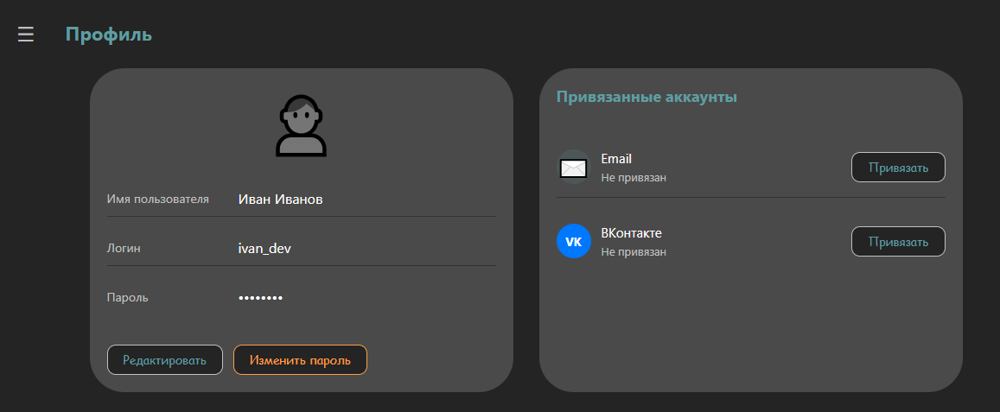

- Редактирование основных данных пользователя;

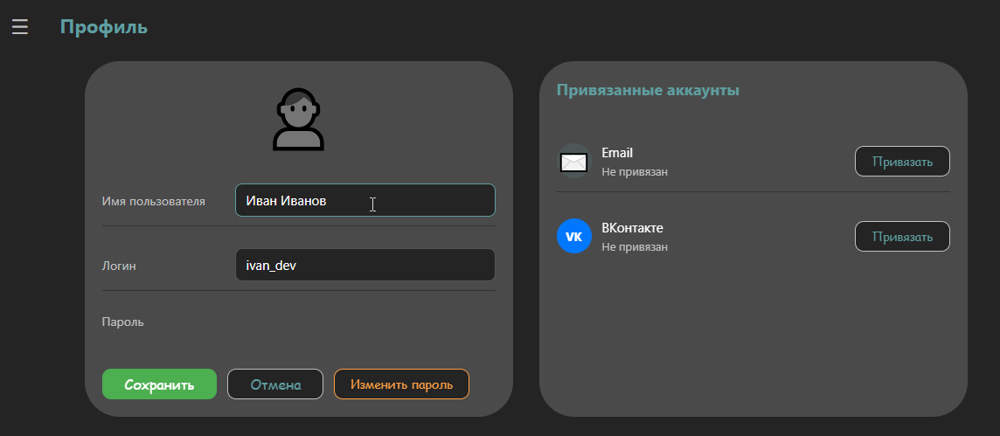

- Изменение пароля по подтверждению текущего;

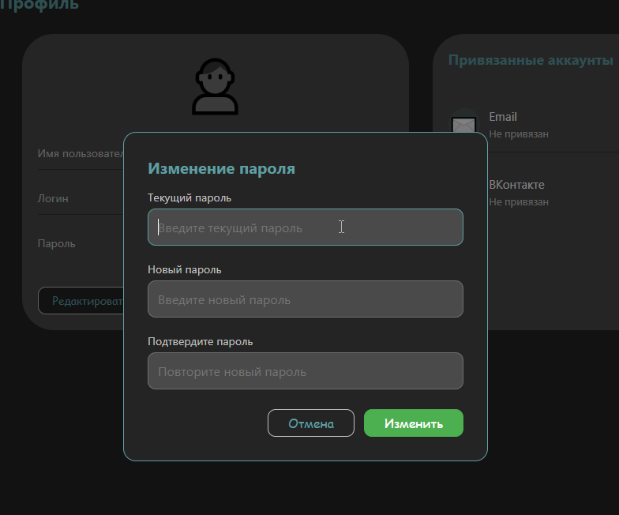

- Привязка Email или VK (если не привязали при регистрации)

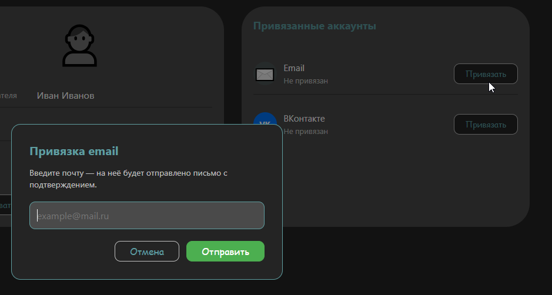

При указании почты, отправляется письмо с подтверждением, о чем нам сообщает уведомление снизу

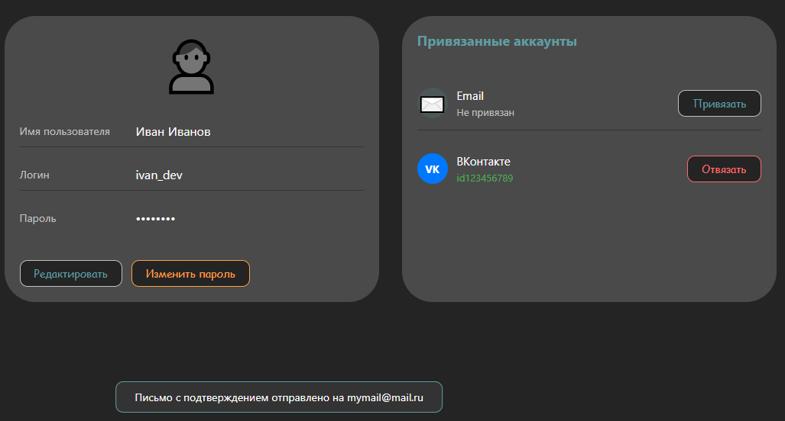

Вот так выглядят привязанные сервисы (можно отвязать)

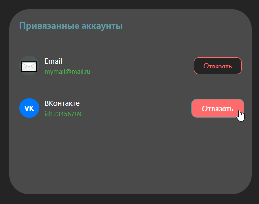

---
# 💻 Локальный запуск

Если хотите протестировать прототип на своем пк, после клонирования репозитория, при открытии любой страницы, вас будет перекидывать на Login page.

Тестовые данные для входа:
login: `admin` 
password: `12345`

>Примечание: данные для входа прописаны в самом коде в login.html, при логине создается токен доступа в памяти, без которого вас не будет пускать на другие страницы.

